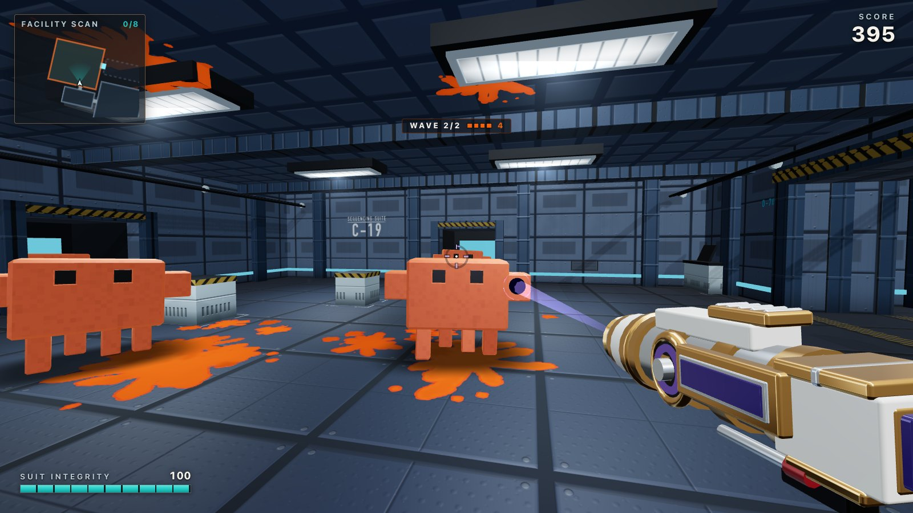
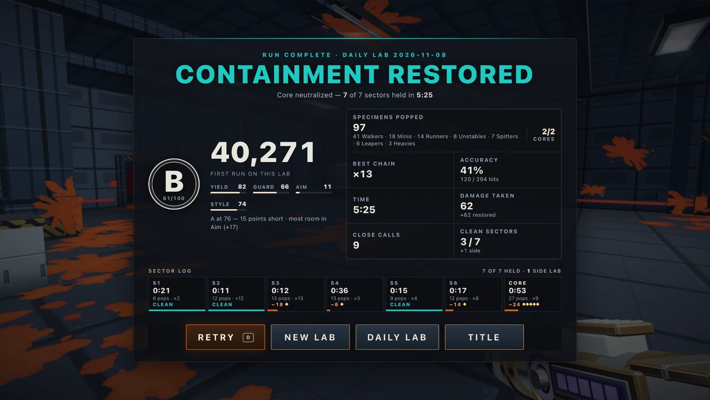
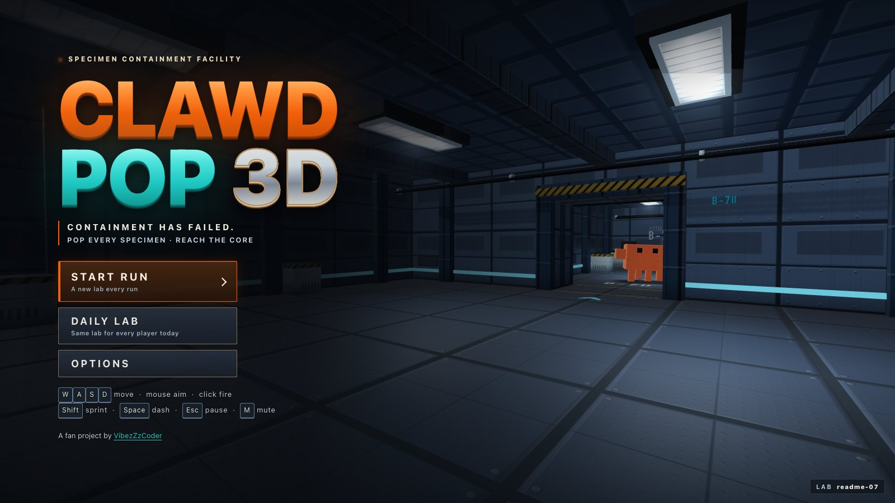
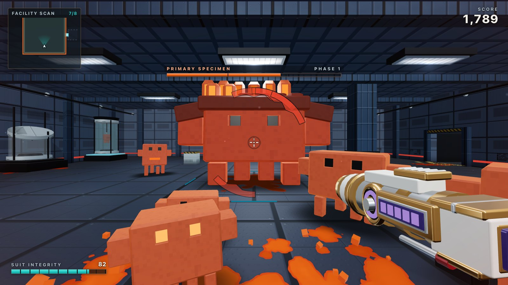

# Clawd Pop 3D

A free fan game: a fast, first-person arcade shooter. Containment has failed: fight through
a freshly generated laboratory every run, pop blocky orange specimens with a
gold-and-silver black-hole cannon, paint the facility orange, shut down the
containment machine and take on the swarm boss in the core chamber.

> **Play now:** [Launch Clawd Pop 3D](https://vibezzzcoder.github.io/clawd-pop/)
> — in the browser, on desktop, phone or tablet. No install, no account.



Everything you see and hear is generated by the game as it starts: the
facility, the specimens, the cannon, textures, lighting, effects, sound and
music. No image, sound or font files ship with it.

## What a run looks like

- **A new laboratory every run.** Rooms, corridors, side labs, props and
  hazards are laid out from a seed; replaying a seed rebuilds the same facility.
- **Seven or eight sectors to hold.** Each fight introduces something: Walkers
  first, then Runners, Unstables, Leapers, Spitters and Heavies, each announced
  the first time it appears.
- **A mid-run landmark.** The containment machine rises on a lift halfway
  through. Its armour turns shots aside — break its three glowing power cells.
- **The core chamber.** The swarm boss rises at the end, releases mini-Clawds
  and changes pattern as it weakens. Pop it and the whole brood bursts with it.
- **The facility turns on you.** Deeper sectors get darker, louder and messier:
  breached tanks, contamination on the floors, alarms and a heavier score.
- **Score and grade.** Chains, close calls and clean sectors score; the Results
  card grades the run on yield, guard, aim and style and keeps your bests.





## Specimens

| Specimen | What it does | How to beat it |
| --- | --- | --- |
| Walker | Closes in and lunges | Pop it before the wind-up ends |
| Runner | Fast, comes in pairs | Lead your shots and keep moving |
| Unstable | Rushes you and bursts | Pop it among others — its blast chains |
| Leaper | Pounces from range | Sidestep the landing ring |
| Spitter | Hangs back and spits | Dodge, then close in |
| Heavy | Big, slow, three shots | Each hit knocks it back |

A specimen's eyes flash before it attacks; an arc at the edge of the screen
warns you about anything winding up behind you.

## Daily Lab

**Daily Lab** on the title screen plays today's laboratory: the same layout for
every player on the same calendar date, with its own best score. **Start Run**
always builds a new random lab. You can also replay any lab from its seed, shown
in the corner of the title screen, with `?seed=<seed>` on the page address.

## Controls

### Keyboard and mouse

| Action | Control |
| --- | --- |
| Move | `W` `A` `S` `D` |
| Aim | Mouse (click to capture), or click and drag |
| Fire | Left click — hold to keep firing |
| Sprint | `Shift` |
| Dash | `Space` |
| Pause | `Esc` |
| Mute | `M` |
| Retry the same lab | `R` on the Results card |

If the browser declines to capture the pointer, click-and-drag aiming and firing
still work.

### Phone and tablet

- **Move** with the left stick; push past its rim to run.
- **Aim** by dragging on the right side of the screen.
- **Fire** with the Fire button — hold it and slide to shoot while turning — or
  tap the aim area to fire a single shot at the reticle.
- **Dash** with the Dash button.
- **Pause** from the top centre; **Run** at the top right toggles running.

Landscape plays best; portrait works too.

### Install it like an app

On iPhone or iPad, open the game in Safari, tap **Share**, then **Add to Home
Screen**. It gets its own icon and opens full screen without the browser bars.
On Android, use Chrome's **Install app** or **Add to Home screen**.

## Options

Options are on the title and pause screens and are saved on your device.

- **Audio:** master, effects, music and ambience volume, and mute.
- **Controls:** mouse and touch sensitivity, inverted aim, touch auto-fire
  (a resting thumb keeps firing) and haptics.
- **Display:** graphics quality (probed for your device), adaptive resolution,
  renderer (Auto, WebGPU or WebGL) and a frame rate counter.
- **Accessibility:** screen shake (full, reduced or off), reduced motion and
  hints.

Nothing in Options changes the laboratory a seed generates.

## Graphics

The game draws with **WebGPU** wherever the browser supports it and falls back
to **WebGL 2** everywhere else, automatically. Both renderers draw the same
picture. Each player downloads only the renderer their browser will use, about
0.3–0.4 MB compressed.



## Preview a downloaded copy

The game uses JavaScript modules, so serve the folder rather than opening
`index.html` directly. One simple local command is:

```sh
python3 -m http.server 8000
```

Then visit `http://127.0.0.1:8000/`.

## License and notice

The game is released under the [MIT License](LICENSE). See
[NOTICE.md](NOTICE.md) for the fan-project disclaimer and the Three.js license.
